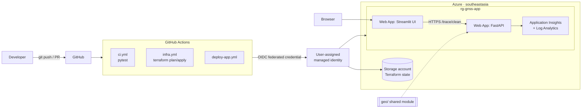

# GNSS Trace Quality Checker on Azure + Databricks

A personal proof-of-concept that cleans **simulated** vehicle GNSS traces: it flags multipath jumps,
smooths the trajectory with a Kalman filter and checks whether the vehicle stayed inside an
operational design domain (ODD). It runs as a FastAPI + Streamlit app on Azure App Service. All
algorithm logic lives in one shared `geo/` Python module (a Databricks pipeline reusing it is planned).

> **All data in this project is simulated.** No real vehicle data is used. The simulator keeps the
> ground truth so the smoothing error can be measured.

Skills shown: Azure (App Service, Application Insights, managed identity), Terraform (remote state),
GitHub Actions with OIDC (no stored secrets), Python (FastAPI, Streamlit, pandas, Shapely).

## Architecture



| Folder | What it is |
|---|---|
| `geo/` | Algorithms (`geo.py`) and simulator (`generate_trace.py`). Pure functions, no I/O. |
| `api/` | FastAPI app + pytest tests (`api/tests`). |
| `ui/` | Streamlit app; calls the API at `API_URL`. |
| `infra/bootstrap` | Storage account for Terraform state (local state, applied once). |
| `infra/app` | App Service plan B1, 2 web apps, App Insights, GitHub OIDC identity. |
| `.github/workflows` | `ci`, `infra`, `deploy-app`. |
| `reference/demo.py` | Original prototype; source of truth for the algorithms. |

## Algorithms

1. **Local frame** – lat/lon → metres around the first point (equirectangular).
2. **Anomalies** – implied speed between consecutive points > 200 km/h (configurable). A jump makes
   the step in *and* out too fast, so the point between them is flagged.
3. **Kalman filter** – state `[x, y, vx, vy]`, constant velocity, dt = 1 s, R = (4 m)² I. The update is
   skipped for flagged points and when the innovation Mahalanobis² > 16 (gating).
4. **ODD check** – point-in-polygon (Shapely) on the smoothed track: % of time inside, enter/exit times.
5. **Simulator** – waypoints at ~10 m/s, 1 Hz, Gaussian noise ~4 m, multipath jumps of 80–180 m.

CSV contract: input `timestamp,lat,lon` (ISO 8601, 1 Hz) → output adds `is_anomaly,smooth_lat,smooth_lon,in_odd`.
Extra columns (e.g. `true_lat,true_lon`) are passed through.

## Run locally

Python 3.12 (3.13 also works for local dev).

```bash
python -m venv .venv
.venv/Scripts/activate            # Windows  (Linux/macOS: source .venv/bin/activate)
pip install -r api/requirements-dev.txt -r ui/requirements.txt
pytest                            # geo + API tests
python -m geo.generate_trace --seed 1 --out sample.csv
```

Start the API and the UI in two terminals:

```bash
cd api && uvicorn main:app --reload --port 8000      # docs at http://localhost:8000/docs
```

```bash
streamlit run ui/app.py                               # http://localhost:8501, uses API_URL=http://localhost:8000
```

### API

| Method | Path | Input | Output |
|---|---|---|---|
| GET | `/health` | – | `{"status":"ok"}` |
| GET | `/trace/sample` | `seed`, `noise_m`, `n_jumps` | simulated CSV with ground truth |
| POST | `/trace/stats` | CSV file, `max_kmh` | trip stats JSON |
| POST | `/trace/anomalies` | CSV file, `max_kmh` | flagged points with implied speed |
| POST | `/trace/smooth` | CSV file | cleaned CSV download |
| POST | `/trace/odd-check` | CSV file, form `polygon` (GeoJSON, `[lon, lat]`) | % inside, enter/exit events |
| POST | `/trace/clean` | CSV file, optional `polygon` or `use_default_odd=true` | `{"summary": …, "points": […]}` |

Bad input (missing columns, non-ISO timestamps, invalid lat/lon or polygon) returns **422** with a clear message.

**Why `geo/` is copied into the API package on deploy:** App Service runs `gunicorn … main:app` from the
deployed folder. Copying `geo/` next to `main.py` in `deploy-app.yml` keeps one source of truth in git
without publishing a pip package. Locally `api/main.py` adds the repo root to `sys.path` instead.

## Deploy to Azure

Constraints: Azure for Students, `southeastasia`, ≤ 4 vCPU per region, budget < 10 USD.

### 1. Bootstrap Terraform state (once, locally)

```bash
az login
az account set --subscription <subscription-id>
cd infra/bootstrap
cp terraform.tfvars.example terraform.tfvars      # fill subscription_id
terraform init && terraform apply
terraform output backend_hcl                       # -> paste into infra/app/backend.hcl
terraform output storage_account_id                # -> tfstate_storage_account_id in infra/app/terraform.tfvars
```

### 2. App infrastructure (first apply locally, later via GitHub Actions)

```bash
cd infra/app
cp terraform.tfvars.example terraform.tfvars      # subscription_id, github_owner, github_repo, tfstate_storage_account_id
cp backend.hcl.example backend.hcl                 # values from step 1
terraform init -backend-config=backend.hcl
terraform apply
terraform output
```

The first apply must run locally (as subscription Owner) because it creates the role assignments for the
GitHub identity: Contributor on `rg-gnss-app`, Reader on the subscription (so CI `plan` can refresh) and
Storage Blob Data Contributor on the state account.

### 3. GitHub secrets and variables

Settings → Secrets and variables → Actions. The secrets are identifiers, not passwords (OIDC).

| Kind | Name | Value |
|---|---|---|
| Secret | `AZURE_CLIENT_ID` | `terraform output github_identity_client_id` (infra/app) |
| Secret | `AZURE_TENANT_ID` | `terraform output tenant_id` |
| Secret | `AZURE_SUBSCRIPTION_ID` | `terraform output subscription_id` |
| Variable | `TFSTATE_RESOURCE_GROUP` | `rg-gnss-tfstate` (bootstrap output) |
| Variable | `TFSTATE_STORAGE_ACCOUNT` | bootstrap output `storage_account_name` |
| Variable | `API_APP_NAME` | `terraform output api_app_name` |
| Variable | `UI_APP_NAME` | `terraform output ui_app_name` |

### 4. Workflows

| Workflow | Trigger | Does |
|---|---|---|
| `ci.yml` | pull request | Python 3.12, install, `pytest` |
| `infra.yml` | PR / push to `main` touching `infra/app/**` | `fmt -check`, `init`, `validate`, `plan`; `apply` on `main` |
| `deploy-app.yml` | push to `main` touching `api/**`, `ui/**`, `geo/**` | tests, then matrix `[api, ui]` → `azure/webapps-deploy@v3`, API health smoke test |

All Azure logins use `azure/login@v2` with OIDC (`permissions: id-token: write`). Terraform jobs share a
concurrency group so two applies never run at once. Federated credential subjects:
`repo:<owner>/<repo>:ref:refs/heads/main` and `repo:<owner>/<repo>:pull_request`.

Tear down when you do not need the demo:

```bash
cd infra/app && terraform destroy
```

### Observability

When `APPLICATIONINSIGHTS_CONNECTION_STRING` is set, the API configures `azure-monitor-opentelemetry`:
requests, exceptions and logs go to Application Insights. `/trace/clean` logs the trip size, anomaly
count and processing time (custom dimensions `trip_points`, `anomalies`, `processing_ms`).

```kusto
traces
| where message startswith "trace cleaned"
| project timestamp, points = toint(customDimensions.trip_points), ms = todouble(customDimensions.processing_ms)
```

## Screenshots

_To add after the real runs (put files in `docs/screenshots/`):_

- [ ] Streamlit UI on Azure (map with raw / smoothed / anomalies / ODD)
- [ ] GitHub Actions: all workflows green
- [ ] `terraform plan` on a pull request
- [ ] Application Insights: requests + `trace cleaned` logs

## Results

_Placeholders – fill in with numbers from real runs. Data is simulated._

| Metric | Value |
|---|---|
| API `/trace/clean` processing time (App Insights, p50) | _TBD_ ms |
| Azure cost for the project | _TBD_ USD |
